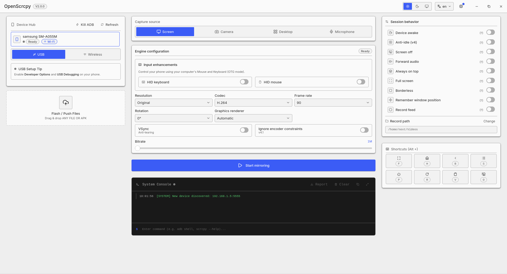
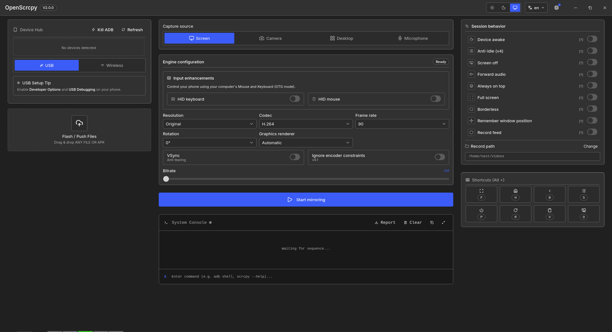

<div align="center">


# OpenScrcpy

**Control your Android from the desktop. Mirror the screen, use it as a webcam, or open a virtual display.**

[](https://github.com/yanhenrique-dev/OpenScrcpy/actions/workflows/pull_request.yml)
[](https://github.com/yanhenrique-dev/OpenScrcpy/releases/latest)
[](LICENSE)
[](#installation)

`Linux` · `Windows` · `macOS`

[](https://pt.liberapay.com/mryofc/)

</div>

---

## Screenshots

| Light | Dark |
| ----- | ---- |
|  |  |

---

## Features

- **Mirror, camera, desktop and microphone modes** — screen mirroring, phone-as-webcam with lens, torch and zoom controls, a virtual display with flex resize, and audio routing.
- **Precision input over OTG/HID** — hardware keyboard and mouse simulation, side by side.
- **Wireless pairing with history** — pair Android 11+ devices over Wi-Fi and reconnect in one click.
- **One-click core setup** — automatic core binary download and update checks, right from the header.
- **Render driver selection** — capability-aware graphics backends, filtered by OS.
- **Drag and drop files** — drop an APK to install it, or push any file to `/sdcard/Download/`.
- **Runs in the background** — close the window to the tray and keep mirror, camera, desktop and microphone sessions alive; quit from the tray to stop them.
- **In-app update notices** — checks the GitHub releases and installs the signed update from inside the app.

---

## Requirements

- **Android 5.0+** — Android 11+ for wireless debugging; Android 12+ for camera mode.
- **USB debugging** enabled on the device (and **Wireless debugging** for Wi-Fi connections).
- **Desktop** — Linux x86_64, Windows x64, and a universal macOS build (Intel and Apple Silicon).

---

## Installation

### Quick start

1. Download the latest release from [Releases](https://github.com/yanhenrique-dev/OpenScrcpy/releases).
2. Enable **USB debugging** on your Android device (plus **Wireless debugging** for Wi-Fi connections).
3. Follow the full walkthrough in [GUIDE.md](GUIDE.md).

The published Windows and macOS builds are not code-signed, so the OS may show a
SmartScreen or Gatekeeper warning on first launch. The guide explains how to
allow the app.

### NixOS (flakes)

To install it permanently with a desktop launcher, add the flake to your system's `flake.nix`:

```nix
inputs.openscrcpy.url = "git+https://github.com/yanhenrique-dev/OpenScrcpy";
```

Then add it to your system packages:

```nix
environment.systemPackages = [
  inputs.openscrcpy.packages.${pkgs.system}.default
];
```

### Optional runtime tools

The core mirror only needs `adb` and `scrcpy`, which OpenScrcpy can download for
you. A few desktop features use host tools when available:

| Feature | Linux | macOS | Windows |
| --- | --- | --- | --- |
| Remember/recentre the mirror window | `xdotool` (X11/XWayland) | Accessibility permission for OpenScrcpy | — |
| Microphone bridge and level meter | `pactl` + `parec` (PulseAudio/PipeWire) | — | — |

Without them the rest of the app keeps working; the affected action logs a
warning and falls back to the platform default. On **KDE Plasma Wayland**,
window-position memory and the recentre shortcut use KWin's own scripting
interface instead of `xdotool`, so no extra host tool is required.

---

## Development

### Prerequisites

- Node.js 22.12+ (CI uses Node 24)
- The Rust toolchain and Cargo
- The [Tauri desktop prerequisites](https://v2.tauri.app/start/prerequisites/) for your OS

### Build

1. `npm ci`
2. `npm run tauri dev` — development
3. `npm run tauri build` — production

The production build signs the updater artifacts, so it needs
`TAURI_SIGNING_PRIVATE_KEY` and `TAURI_SIGNING_PRIVATE_KEY_PASSWORD`. For a
local build without a signing key, use the local override:

```bash
npm run tauri build -- --config src-tauri/tauri.local.conf.json
```

### Tests

```bash
npm run lint          # TypeScript + Svelte checks
npm test              # frontend tests (Vitest)
(cd src-tauri && cargo fmt --check && cargo clippy --all-targets -- -D warnings && cargo test)
```

### Updates

The app updates through the Tauri updater plugin, which polls
`releases/latest/download/latest.json` on GitHub. `scripts/publish-release.mjs
manifest` builds that asset from the published release assets: it maps each
platform to the signed artifact and uses the release body as the notes. An
empty body falls back to `Release v<version>` instead of the old placeholder.
The manifest is uploaded to the release itself, so the protected `main` branch
is never written by the release bot.

The manual and automated release steps are documented in
[docs/RELEASING.md](docs/RELEASING.md).

The app version must match in `package.json`, `src-tauri/tauri.conf.json`,
`src-tauri/Cargo.toml` and `src-tauri/Cargo.lock`.
`scripts/__tests__/version-consistency.test.ts` enforces it.
The live updater manifest is generated at release time;
`scripts/__tests__/fixtures/latest.json` is only a fixture for the tests.

---

## Security

The in-app console runs only the `adb` and `scrcpy` binaries resolved by the
app, not an arbitrary shell. It is meant for device and session commands.

Found a vulnerability? Read [SECURITY.md](SECURITY.md) — report it privately, never in a public issue.

## Contributing

Bug reports, feature requests and pull requests are welcome. Read
[CONTRIBUTING.md](CONTRIBUTING.md) before opening a PR and follow the
[Code of Conduct](CODE_OF_CONDUCT.md).

## License

This project is licensed under the MIT License — see the [LICENSE](LICENSE) file for details.
