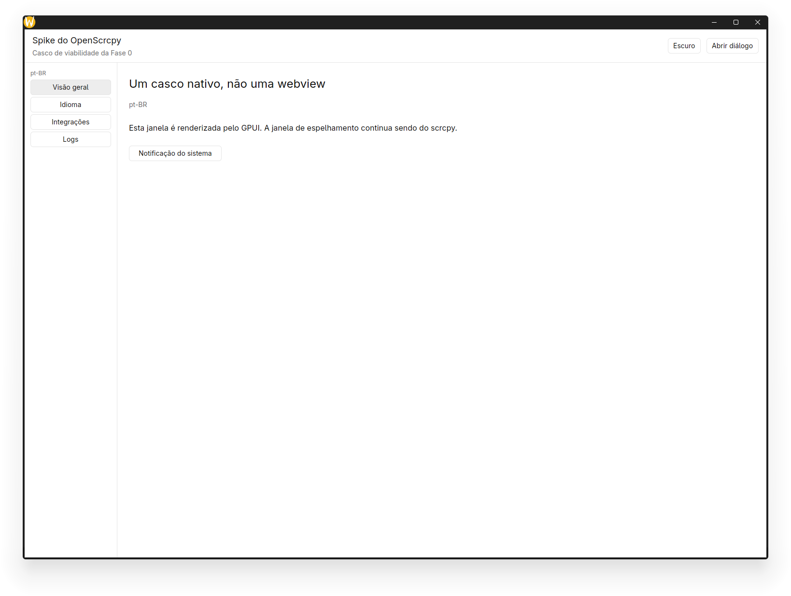
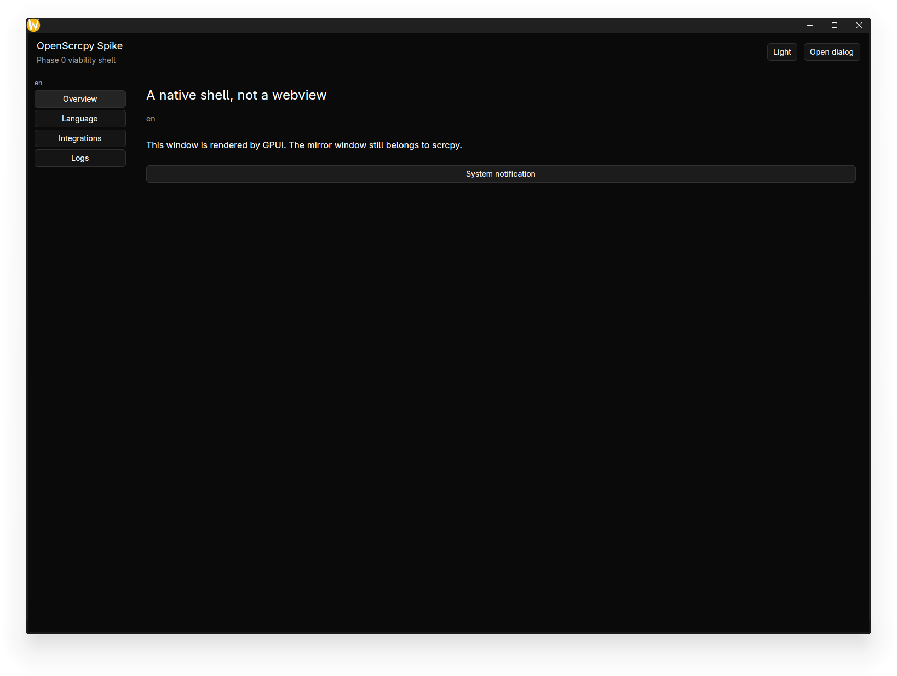
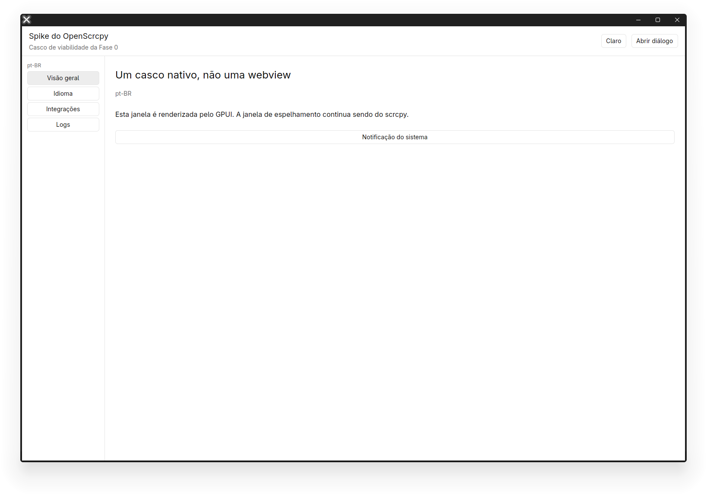
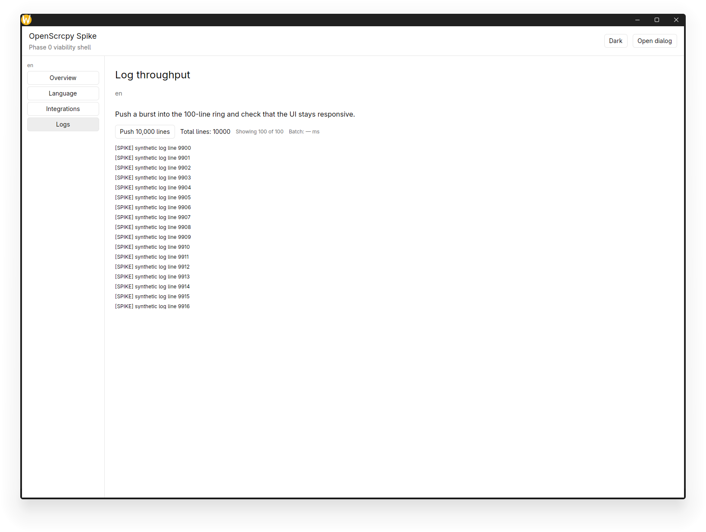
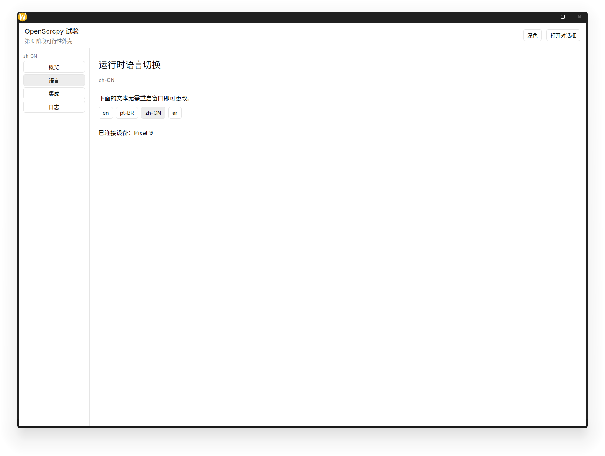
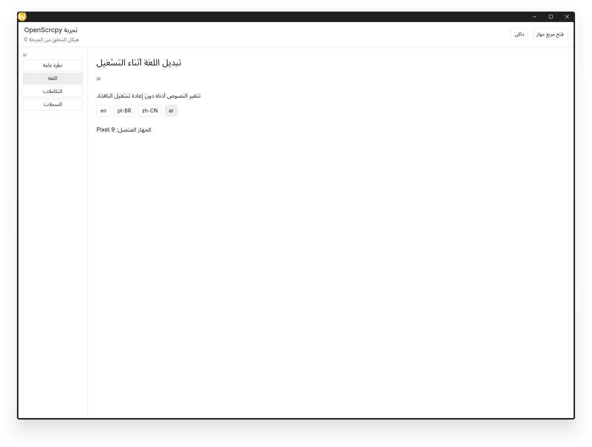
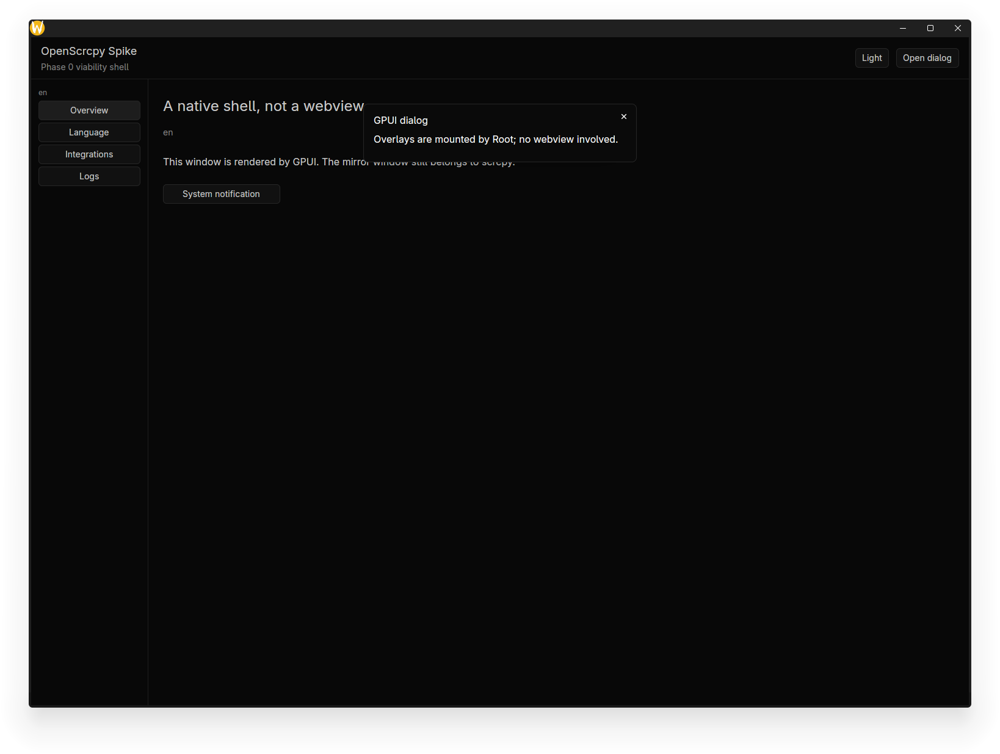

# Spike GPUI Kit — relatório da Fase 0

> **Status:** GO condicional (Fase 1 liberada; Fases 2–6 ainda bloqueadas)
> **Data:** 2026-11-22
> **Alvo:** `gpui-kit = "=0.10.0"` (`gpui-pre = 0.3.12`)
> **Plano:** [docs/GPUI-MIGRATION.md](../GPUI-MIGRATION.md)
> **Código:** [spike/gpui](../../spike/gpui)

## 1. Resumo

O spike foi construído e executado neste host Linux (CachyOS, KDE Wayland). O
casco mínimo abre, troca tema e idioma em runtime, renderiza CJK e árabe,
registra tray via StatusNotifierItem, abre dialog, publica notificação do
sistema, impede uma segunda instância e verifica uma assinatura Minisign de
updater.

O que **não** foi provado: macOS, Windows, GNOME, instalação empacotada,
download/instalação de update, IME real de composição, entrega de hotkey
global no Wayland e drag-and-drop.

**Recomendação:** liberar apenas a Fase 1 (extração do core). Não iniciar a
Fase 3 (telas) antes de fechar os bloqueios da seção 7.

## 2. Ambiente

| Item | Valor |
| --- | --- |
| SO | CachyOS (Arch-like), kernel 7.3.4 |
| Sessão | KDE Plasma, Wayland (`wayland-1`) + XWayland (`:0`) |
| GPU | AMD RX 590 GME, RADV, Mesa 26.2.6 |
| Vulkan | 1.4.363 |
| Rust | 1.99.1 (stable) |
| RAM | 7,6 GB + 7,6 GB zram |
| Build | `cargo build`, `CARGO_BUILD_JOBS=2` |

O host já tinha o OpenScrcpy 2.0 (AppImage) em execução, incluindo o atalho
global `Ctrl+Alt+Shift+C`. Isso foi útil: comprovou o conflito esperado entre
as duas versões.

## 3. O que foi implementado

`spike/gpui/` é um workspace Cargo independente, com:

- shell GPUI com header, sidebar, quatro telas e overlay de dialog;
- tema claro/escuro via `Theme::change`;
- i18n em `rust-i18n` com `en`, `pt-BR`, `zh-CN`, `ar` e troca em runtime;
- `LogBuffer` de 100 linhas com teste de unidade;
- tray Linux via `ksni` (feature `blocking` + `async-io`);
- hotkey global via `global-hotkey`, com override `SPIKE_HOTKEY=F12`;
- instância única via `single-instance`, com saída limpa da segunda instância;
- notificação do sistema via `SystemNotification` e dialog via `Root`/`WindowExt`;
- updater: parser de manifesto + verificação Minisign, com binário de checagem;
- testes de UI em `tests/ui.rs` (`#[gpui_kit::test]`), executados (3/3).

## 4. Resultados

### 4.1 Matrix de plataforma

| Verificação | KDE Wayland | X11 | GNOME Wayland | Windows | macOS 15 |
| --- | --- | --- | --- | --- | --- |
| Janela abre e renderiza | PASS | PASS | UNTESTED | UNTESTED | UNTESTED |
| Tema claro/escuro | PASS | PASS | UNTESTED | UNTESTED | UNTESTED |
| Troca de locale em runtime | PASS | UNTESTED | UNTESTED | UNTESTED | UNTESTED |
| Texto CJK | PASS | UNTESTED | UNTESTED | UNTESTED | UNTESTED |
| Árabe: shaping | PASS | UNTESTED | UNTESTED | UNTESTED | UNTESTED |
| Árabe: layout espelhado | **FAIL** (não espelha) | UNTESTED | UNTESTED | UNTESTED | UNTESTED |
| Tray / StatusNotifierItem | PASS | UNTESTED | UNTESTED | UNTESTED | UNTESTED |
| Hotkey global: registro | PASS (F12) | UNTESTED | UNTESTED | UNTESTED | UNTESTED |
| Hotkey global: entrega | UNTESTED | UNTESTED | UNTESTED | UNTESTED | UNTESTED |
| Instância única | PASS | UNTESTED | UNTESTED | UNTESTED | UNTESTED |
| Notificação do sistema | PASS (D-Bus) | UNTESTED | UNTESTED | UNTESTED | UNTESTED |
| Dialog / overlay | PASS | UNTESTED | UNTESTED | UNTESTED | UNTESTED |
| 10k linhas no log | PASS (manual) | UNTESTED | UNTESTED | UNTESTED | UNTESTED |
| Teste de UI headless | PASS (3/3) | UNTESTED | UNTESTED | UNTESTED | UNTESTED |
| Assinatura Minisign | PASS | UNTESTED | UNTESTED | UNTESTED | UNTESTED |
| Instalar update | UNTESTED | UNTESTED | UNTESTED | UNTESTED | UNTESTED |
| Pacote `.deb`/AppImage | UNTESTED | UNTESTED | — | — | — |

### 4.2 Tarefas do plano

| ID | Status | Evidência |
| --- | --- | --- |
| S0.0 Skills oficiais | PASS | `gpui-kit` e `gpui-kit-design-guides` em `.agents/skills/` + lock |
| S0.1 Skeleton | PASS | Screenshots Wayland/X11 |
| S0.2 Matrix de SO | PARCIAL | Só Linux; macOS/Windows não testados |
| S0.3 Tray | PARCIAL | KDE PASS; GNOME/Windows/macOS não testados |
| S0.4 Serviços | PARCIAL | single-instance/dialog/notificação PASS; drag-drop e file picker não testados |
| S0.5 Throughput de logs | PARCIAL | 10k linhas no buffer; stream 1k/s não medido |
| S0.6 Janela externa do scrcpy | UNTESTED | `xdotool` ausente; scrcpy em uso pelo 2.0 |
| S0.7 Updater | PARCIAL | manifesto + Minisign PASS; download/instalação não testados |
| S0.8 i18n + CJK + árabe | PARCIAL | strings/shaping PASS; RTL não espelha |
| S0.9 Teste de UI headless | PASS | 3 testes de UI + 6 unitários |
| S0.10 Packaging | UNTESTED | sem `dpkg-deb`/AppImage no host |
| S0.11 Relatório | PASS | Este documento |

### 4.3 Números (build debug)

| Métrica | Wayland | X11 |
| --- | --- | --- |
| Primeiro frame (quente) | 724 ms | 488 ms |
| Primeiro frame (frio) | 3.084–3.531 ms | — |
| RSS | 148 MB | 144 MB |
| Threads | 49 | 52 |
| Binário debug | 214 MB | 214 MB |

Os números são de build **debug**; não representam release. O primeiro
frame frio no Wayland inclui inicialização de shader/fontes e não deve ser
usado como meta.

### 4.4 Evidências

- Tray registrado no D-Bus:
  `org.kde.StatusNotifierItem-182093-1/StatusNotifierItem` e barramento
  `openscrcpy-gpui` para o PID do spike.
- Notificação: `dbus-monitor` capturou `member=Notify` com
  `app_name="OpenScrcpy Spike"`, `summary="OpenScrcpy Spike"` e
  `body="System notification"`.
- Hotkey: com `SPIKE_HOTKEY=F12`, log `[hotkey] registered`; com o padrão
  `Ctrl+Alt+Shift+C`, log de conflito porque o OpenScrcpy 2.0 estava rodando.
- Segunda instância: `second_exit=0` e log
  `[single-instance] another OpenScrcpy spike is already running`.
- Updater: `cargo run --bin updater-check` →
  `updater-check: Minisign vector + manifest contract OK`.
- Gates: `cargo fmt --check`, `cargo clippy --lib --bins -- -D warnings`,
  `cargo test --lib` (6/6) e `cargo test --test ui` (3/3) passaram.

### 4.5 Screenshots

| Wayland, pt-BR, claro | Wayland, en, escuro |
| --- | --- |
|  |  |

| X11, pt-BR | Logs, 10k linhas |
| --- | --- |
|  |  |

| Chinês (zh-CN) | Árabe (ar) |
| --- | --- |
|  |  |

| Dialog GPUI |
| --- |
|  |

## 5. O que funcionou melhor que o previsto

1. **Tray no Linux sem GTK.** `ksni` registrou o StatusNotifierItem no KDE
   Wayland sem loop GTK e sem libayatana-appindicator. O ponto de decisão D3
   fica bem menos arriscado — falta validar GNOME (que exige extensão SNI).
2. **Chrome nativo.** A janela abriu com decoração do KDE; não foi necessário
   `WindowDecorations::Client` para o spike. O caminho custom continua aberto.
3. **Notificação e dialog** funcionaram com `Root`/`WindowExt`, sem plugin.
4. **Assinatura Minisign** é reutilizável fora do Tauri com `minisign-verify` e
   um vetor de teste conhecido.

## 6. O que falhou ou ficou pior

1. **RTL não existe de graça.** O árabe renderiza com shaping correto, mas a
   sidebar continua à esquerda, o alinhamento não espelha e a linha mista
   `الجهاز المتصل: Pixel 9` saiu com ordem visual estranha. Isso confirma o
   aviso da doc e o bug de bidi.
2. **Hotkey no Wayland.** `global-hotkey` é explicitamente X11-only. O
   registro com F12 passou, mas a entrega com foco em janela Wayland não foi
   provada; o caminho real no Wayland precisa de portal
   `org.freedesktop.portal.GlobalShortcuts` ou KGlobalAccel.
3. **Empacotamento não foi exercitado.** O host é Arch e não tem
   `dpkg-deb`/AppImage; não houve tempo hábil para montar uma release.
4. **Janela externa do scrcpy** não foi testada: `xdotool` ausente e o scrcpy
   do host está em uso pelo 2.0.
5. **IME real** não foi testado: o screenshot prova renderização de caracteres
   chineses, não composição por teclado.

## 7. Bloqueios antes da Fase 3

| # | Bloqueio | Como fechar |
| --- | --- | --- |
| B1 | GNOME Wayland | Rodar o spike em GNOME com extensão AppIndicator; validar tray/notificação |
| B2 | Windows 10/11 | Build + tray (`tray-icon`) + notificação + hotkey + instalador |
| B3 | macOS 15 arm64/x86_64 | Build universal + `.app` + permissão de notificação |
| B4 | Hotkey no Wayland | Protótipo via portal `GlobalShortcuts` ou KGlobalAccel; testar entrega com foco em app Wayland |
| B5 | IME | Testar composição real com teclado Pinyin/Zhuyin em um `Input` |
| B6 | Updater instalável | Baixar/substituir um AppImage real e reiniciar; Windows/macOS com estratégia |
| B7 | Packaging | `.deb`/AppImage/Inno/DMG em VM limpa |
| B8 | RTL | Decisão de produto: investir no espelhamento ou remover `ar` |
| B9 | Janela do scrcpy | Testar `xdotool`/KWin/Win32 a partir do binário GPUI |

## 8. Recomendação

**GO condicional para a Fase 1** (extração do core). Ela não depende das
incógnitas acima e tem valor mesmo se a migração parar.

**NO-GO para a Fase 3** até B1–B9 estarem fechados. A Fase 2 (fundação)
pode começar em paralelo à Fase 1 se houver um segundo dev, mas sem prometer
telas antes dos bloqueios.

Ponto de atenção de produto: o caminho "GPUI + pacote" ainda não tem updater
pronto, e o caminho "macOS 15+" exclui usuários antigos. Nada disso apareceu
no spike Linux; são decisões que continuam abertas.

## 9. Como reproduzir

```sh
cd spike/gpui
cargo build

# tela de idiomas, tema escuro, inglês
SPIKE_LOCALE=en SPIKE_THEME=dark SPIKE_SCREEN=language \
  ./target/debug/openscrcpy-gpui-spike

# logs com 10k linhas no ring
SPIKE_SCREEN=logs SPIKE_SEED_LOGS=10000 \
  ./target/debug/openscrcpy-gpui-spike

# dialog e notificação na abertura
SPIKE_DIALOG=1 SPIKE_NOTIFY=1 \
  ./target/debug/openscrcpy-gpui-spike

# hotkey alternativa (evita conflito com o OpenScrcpy 2.0 aberto)
SPIKE_HOTKEY=F12 ./target/debug/openscrcpy-gpui-spike

# updater (assinatura + manifesto)
cargo run --bin updater-check

# testes
cargo test --lib
cargo test --test ui
```

## 10. Arquivos

- [spike/gpui/src/lib.rs](../../spike/gpui/src/lib.rs) — shell, i18n, logs, dialog
- [spike/gpui/src/integrations.rs](../../spike/gpui/src/integrations.rs) — tray, hotkey, single-instance
- [spike/gpui/src/updater.rs](../../spike/gpui/src/updater.rs) — manifesto + Minisign
- [spike/gpui/src/log_buffer.rs](../../spike/gpui/src/log_buffer.rs) — ring buffer
- [spike/gpui/tests/ui.rs](../../spike/gpui/tests/ui.rs) — testes de UI
- [spike/gpui/locales/ui.yml](../../spike/gpui/locales/ui.yml) — 4 locales
